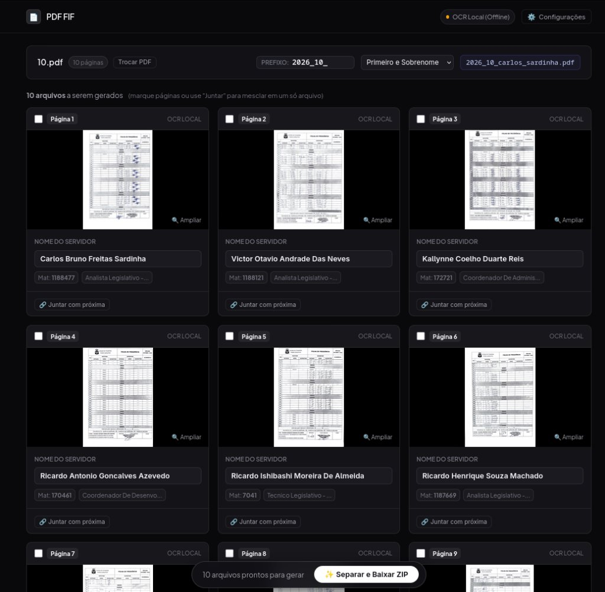

<div align="center">
  <h1>📄 PDF FIF</h1>
  <p><strong>Separador Automático de Folhas Individuais de Frequência (FIF)</strong></p>
  <p>Processa PDFs de frequência escaneados, identifica os nomes via <strong>OCR Local (100% offline)</strong> e gera os arquivos individuais renomeados para download em <code>.ZIP</code>.</p>

  <p>
    <a href="https://render.com/deploy?repo=https://github.com/lk-feitosa/pdf_fif">
      
    </a>
  </p>

  
</div>

---

## 🚀 Como Rodar Localmente

```bash
# Clone e entre no projeto
git clone https://github.com/lk-feitosa/pdf_fif.git
cd pdf_fif

# Inicia direto (instala dependências e abre a interface web)
./run.sh
```

Acesse no navegador: **`http://localhost:8000`**

*(Ou via Docker: `docker build -t pdf-fif . && docker run -p 8000:8000 pdf-fif`)*

---

## ☁️ Deploy no Render

1. Clique no botão **Deploy to Render** acima (ou crie um novo **Web Service** conectado ao repositório).
2. O Render usará o [`Dockerfile`](Dockerfile) automaticamente.
3. Não é necessária nenhuma configuração adicional — o serviço sobe pronto para uso de forma gratuita.

---

## ⚙️ Configurações (.env)

O sistema opera **100% offline** por padrão usando PyMuPDF e Tesseract OCR. A integração com IA do Google Gemini é totalmente opcional:

| Variável | Padrão | Descrição |
|---|:---:|---|
| `PORT` | `8000` | Porta do servidor web. |
| `GEMINI_API_KEY` | *vazia* | *(Opcional)* Chave do Google AI Studio se desejar reforço de IA para folhas danificadas. |
| `GEMINI_MODEL` | `gemini-2.0-flash` | *(Opcional)* Modelo para leitura visual caso a chave seja informada. |
| `TELEGRAM_BOT_TOKEN` | *vazia* | *(Opcional)* Token do bot do Telegram caso queira processar PDFs por lá. |
